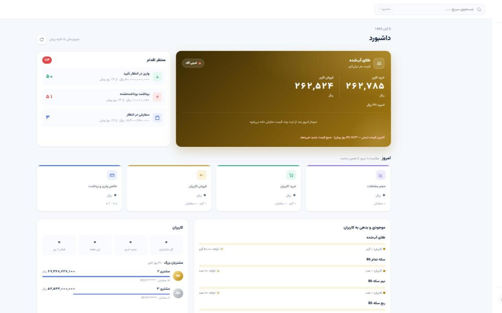
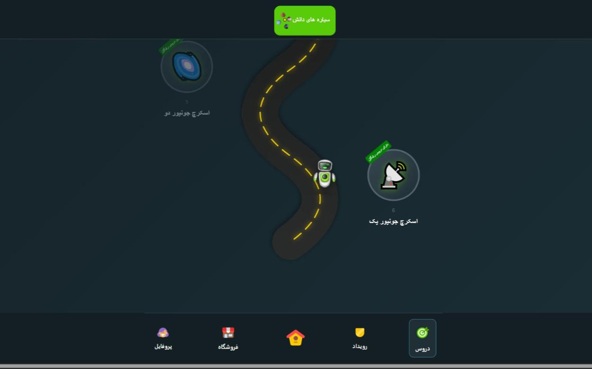
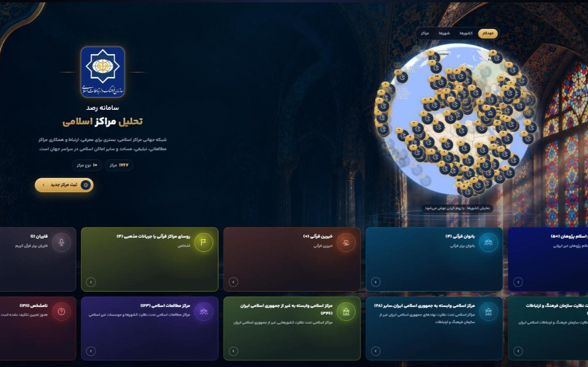
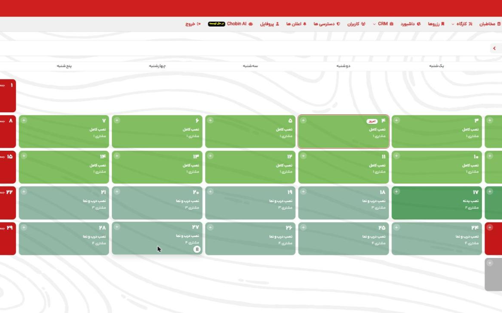
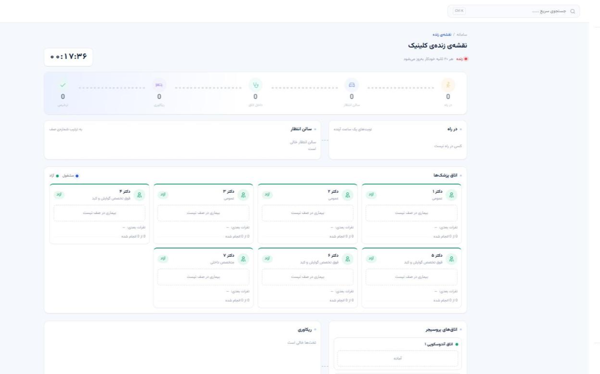
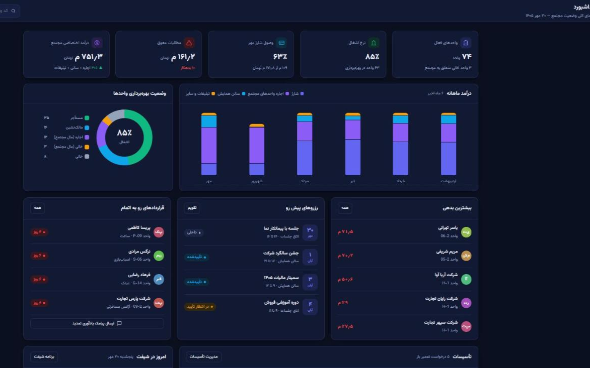
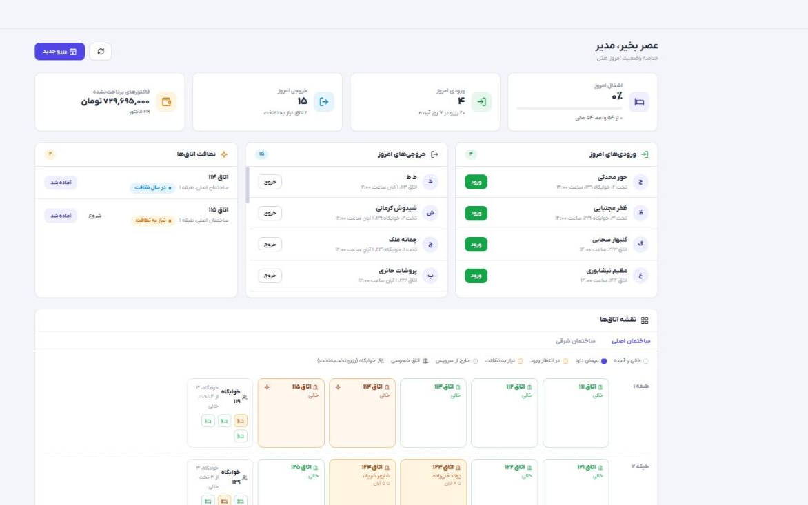
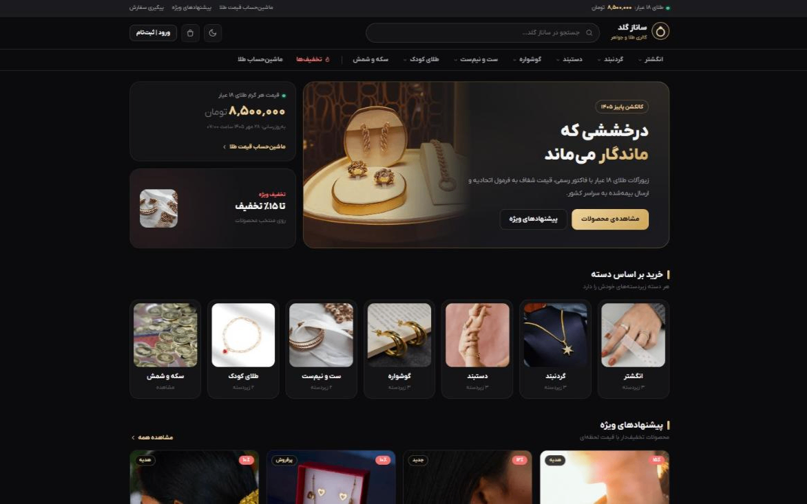

## Hi, I'm Erfan 👋

Full-Stack developer (**Laravel / Angular**), previously Android. Lecturer at University of Kashan.

**Stack:** PHP · Laravel · Angular · TypeScript · MySQL · SQL Server · .NET · Android

Most of my work is client code, so the source is private. Here is what some of it looks like.

---

### Online gold & coin trading platform
Customer app and admin panel: live prices from several providers, price-lock quotes, wallet, treasury, SMS, Telegram bot.
Laravel 12, Reverb, MySQL, Angular 19 · [architecture](https://github.com/erfanashrafpour/gold-trading-platform)

### Botigo, coding education for kids
PWA for students and parents plus an admin panel with 20+ modules, XP and streaks, placement test, OTP login.
Angular (PWA), Laravel, MySQL

### Islamic centers monitoring system
World map and 3D globe of 1,700+ centers, filtered by type, country and city.
Angular, Laravel

### Choobinco, CRM and installation planning
Angular, Laravel, MySQL

### Clinic management (reception, appointments, cash desk)
Angular, Laravel

### Shopping mall management (charges, rent, hall booking)
Angular, Laravel

### Hotel management and room booking
Angular, Laravel, MySQL

### Sanaz gold & jewelry online shop
Angular 19, Laravel

---

Also: Arbaeen World Award (event & submission system), Sepand Jobs (jobs and local services), Zaersara (pilgrim lodging finder), Asanito CRM, Simorgh HR performance system.

📫 erfanashrafpour2000@gmail.com
